# ELEC4-Python-Molano

# ELEC 4 - Python Programming Activities

**Name:** Zheena Collene V. Molano  
**Section:** IV-BSIT-B  
**Course:** ELEC 4 - Python Programming

## Set 1 Activities

### P1 - Student Grade Calculator

A menu-driven program that calculates student grades, average, highest grade, lowest grade, and pass/fail status.

**Run Command:**
```bash
python set1/p1/p1_grade_calculator.py
```

**Screenshot:**

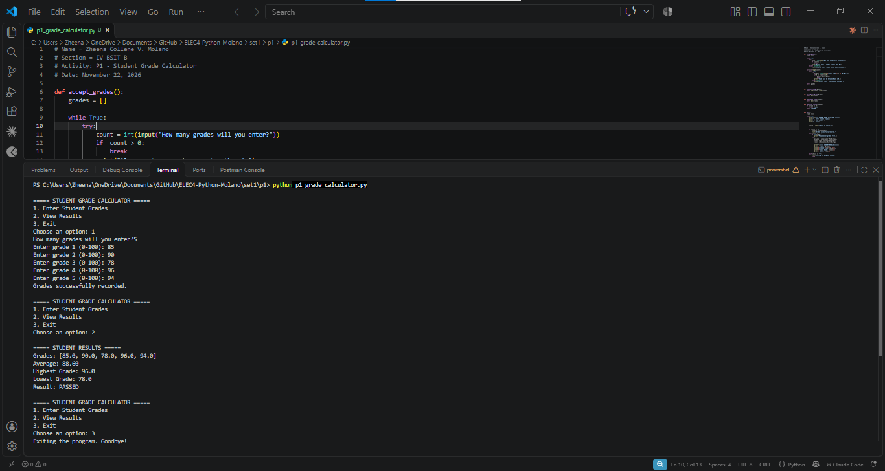

### P2 - Custom Module: student_utils

A program that uses a custom module to calculate the average, pass/fail result, highest grade, and lowest grade.

**Run Command:**
```bash
python set1/p2/p2_main.py
```

**Screenshot:**

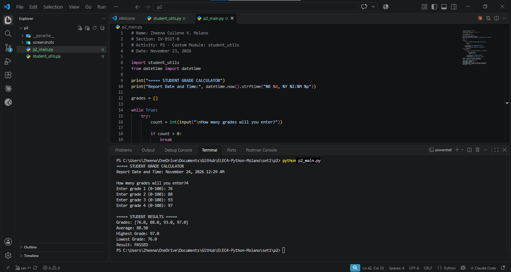

### P3 - Student Record Manager

A menu-driven program that allows users to add, remove, search, and display student records while preventing duplicate entries.

**Run Command:**
```bash
python set1/p3/p3_record_manager.py
```

**Screenshots:**

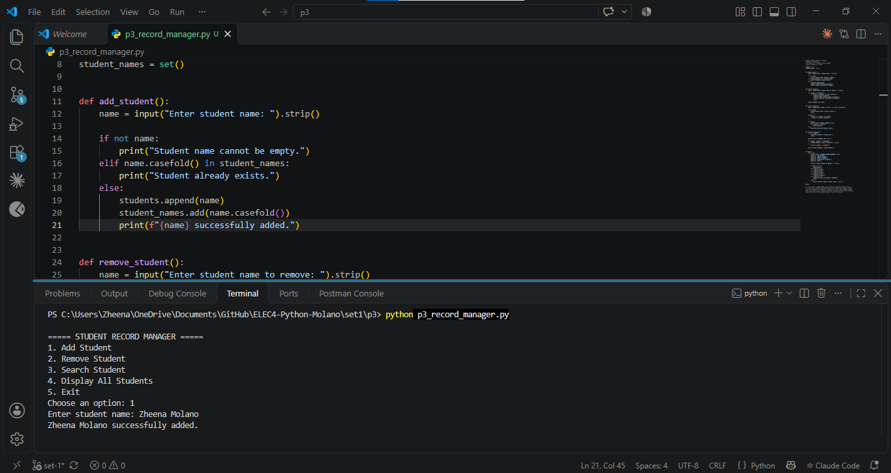

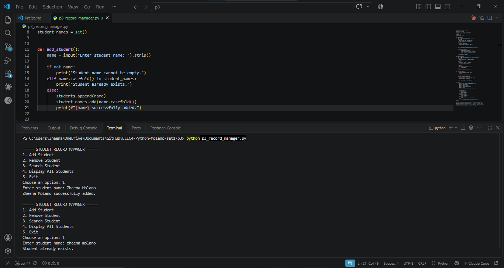

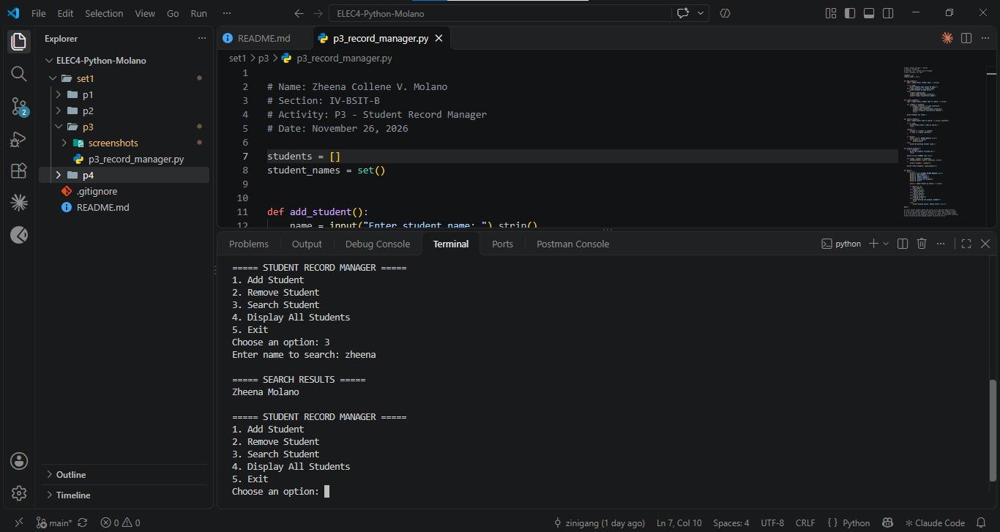

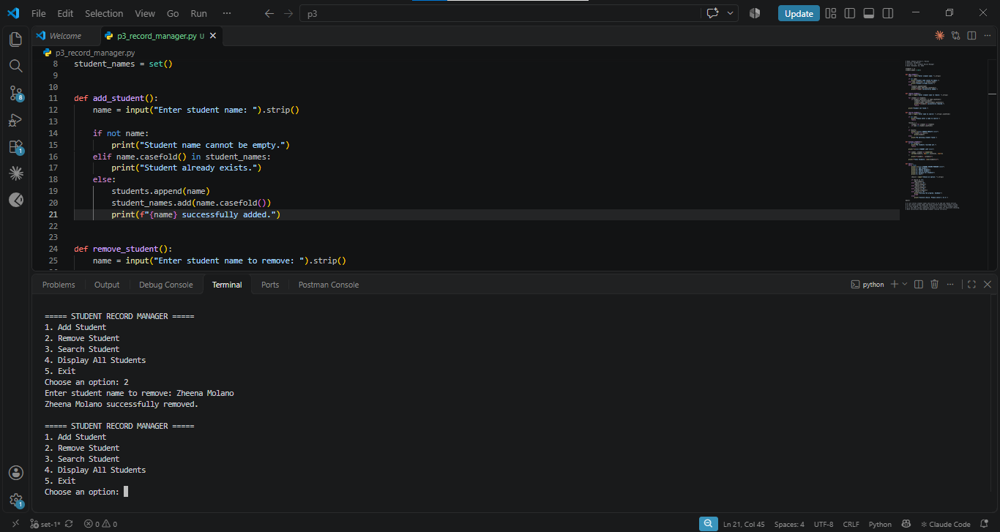

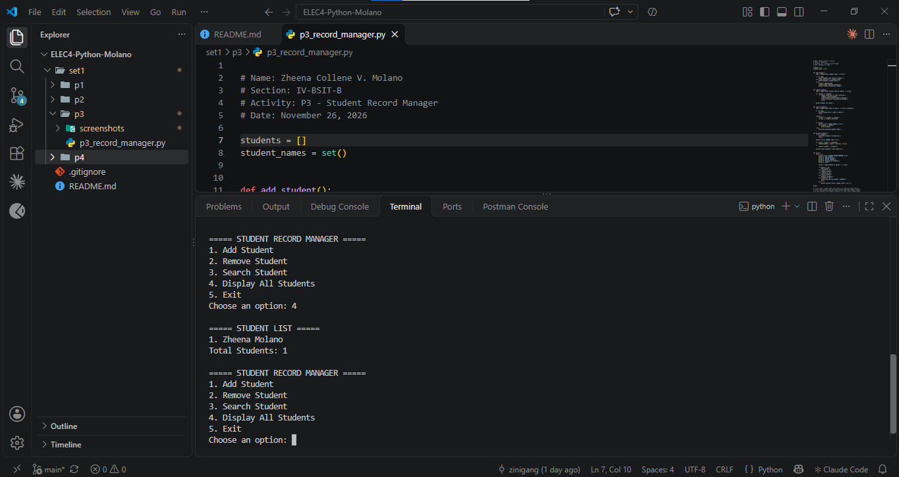

### P4 - Safe Menu Program

A menu-driven program that handles invalid number input, division by zero, missing files, and invalid menu selections using exception handling.

**Run Command:**
```bash
python set1/p4/p4_exceptions.py
```

**Screenshots:**

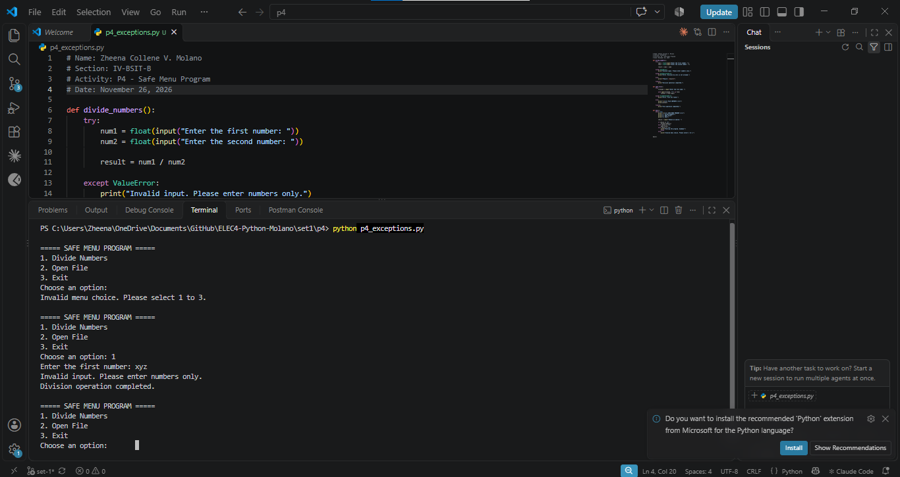

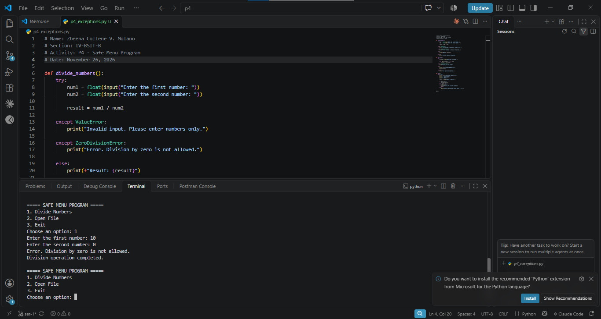

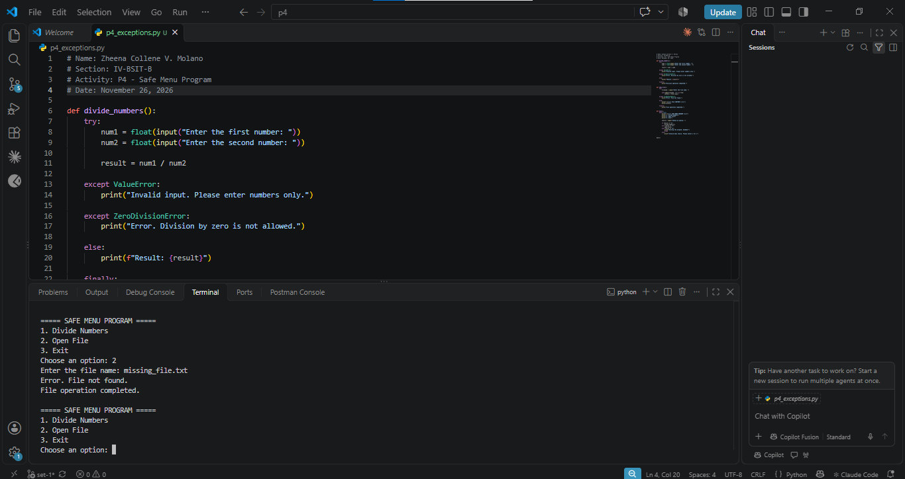

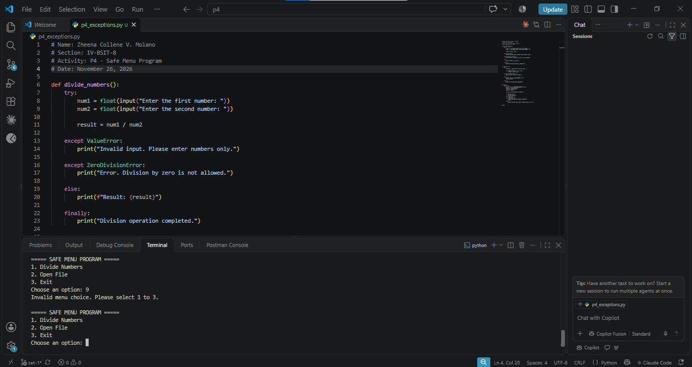
